<p align="center">
  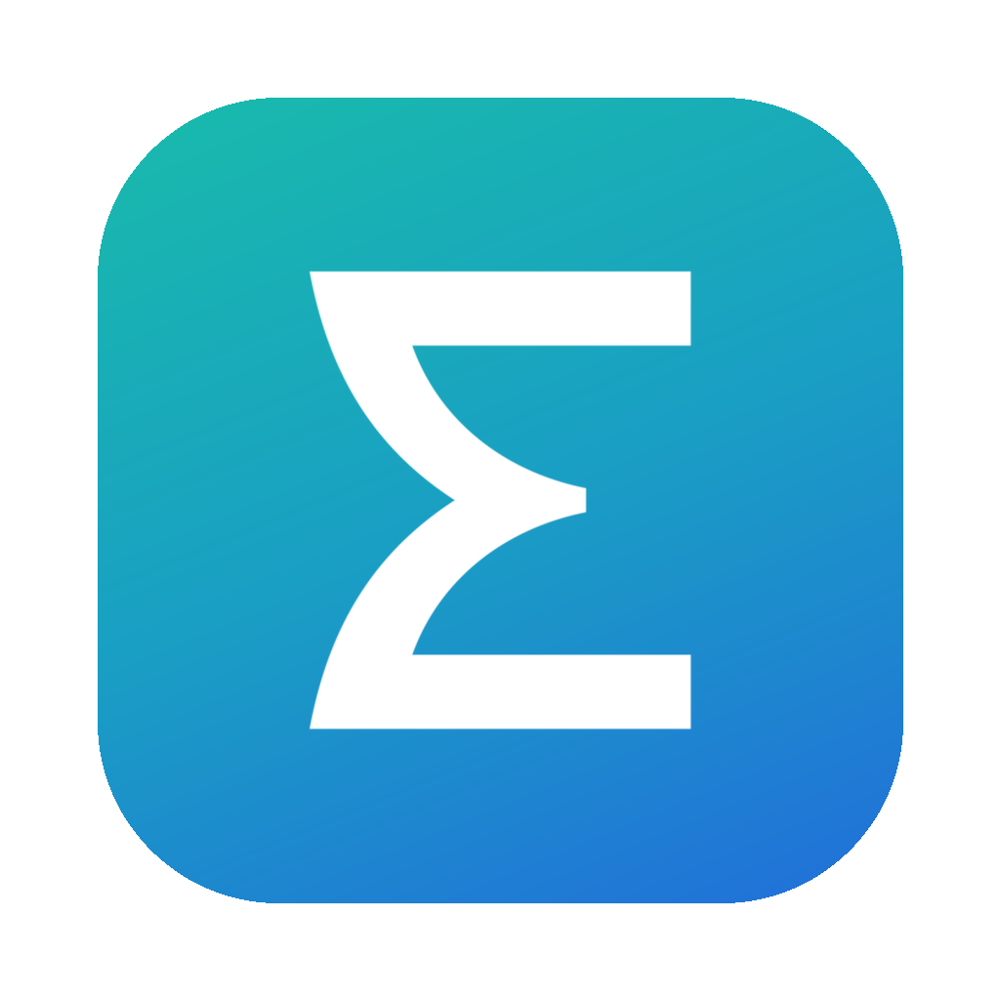
</p>

<h1 align="center">Zebra</h1>

<p align="center">
  <b>A free, open-source Mac app for the Amazfit Helio Strap.</b><br>
  WHOOP-style recovery, sleep and body age. Live heart rate straight from the strap over Bluetooth.<br>
  An AI coach you can run on any provider, or fully offline.
</p>

<p align="center">
  <a href="https://github.com/arjanchaudharyy/zebra-helio-strap/releases/latest"><b>Download for Mac</b></a> ·
  <a href="https://zebra-helio-strap.vercel.app">Website</a> ·
  <a href="#install">Install</a> ·
  <a href="#features">Features</a> ·
  <a href="#credits">Credits</a>
</p>

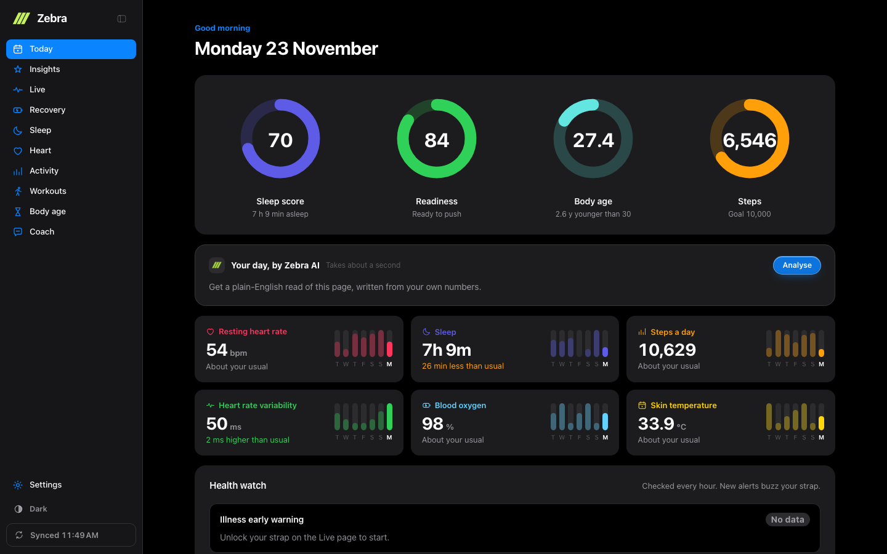

The Helio Strap is great hardware with no desktop app. Zepp shows your data on your phone, and that's it. Zebra puts all of it on your Mac, keeps it in a local database you own, and adds the things we wanted: a body age that does not jump around, weekly insights in plain English, live heart rate, and an AI coach that knows your numbers.

Screenshots use the app's built-in demo data.

## Features

**Your day at a glance**
- Sleep score, readiness, body age and steps as Apple-style rings.
- Resting heart rate, sleep, steps, HRV, blood oxygen and skin temperature, each with one plain sentence ("3 beats higher than usual") and the last 7 days.

**Insights**
- "Your week" highlights: this week against last week for sleep, steps, HRV, readiness, stress and workouts.
- A short daily read and a weekly plan, written by AI from your own numbers.
- Health watch: illness early warning from resting heart rate, HRV, skin temperature and breathing (after 7 nights of baseline). New alerts buzz your strap.

**Live, straight from the strap**
- Zebra connects to the strap over Bluetooth when it starts and stays connected. It reconnects by itself.
- Every heart rate reading (about one a second) is saved on your Mac. The Heart page shows the whole day.

**Recovery, sleep, heart, activity, workouts**
- Readiness, BioCharge, body and mind charge, HRV against your baseline, sleeping heart rate, breathing rate, night oxygen score, oxygen dips, stress and training load, each with what it means and how you compare with your usual.
- Every workout with time, heart rate, calories and training load.

**Body age**
- Built from sleep, sleep consistency, steps, resting heart rate, age-normed HRV and PAI.
- Smoothed, so it moves slowly and never jumps from one day to the next. You can see which habits push it up or down.

**Coach**
- An iMessage-style chat that knows your sleep, heart, recovery and activity.
- Chats are saved. You can edit your last question.
- Pick your AI in Settings: **Sarvam, OpenAI, Anthropic (Claude), OpenRouter, Google Gemini, Groq**, or run it free and private with **Ollama** or **LM Studio**, or point it at **any OpenAI-compatible server**.

**Strap settings from your Mac**
- Read and change the settings stored on the strap: heart rate measurement interval, high and low heart rate alerts, low blood oxygen alert. See the heart rate zones it uses.

**Claude Code on your wrist**
- One buzz when Claude Code finishes. Two buzzes when it needs you. See [Wrist buzz](#wrist-buzz-for-claude-code).

**Ask any AI about your data (MCP)**
- Zebra ships an MCP server with 29 tools: sleep, heart rate, HRV, recovery, workouts, baselines, the strap's every-second heart rate and health alerts.
- Connect it to Claude Code, Codex, Gemini CLI, Claude Desktop, Cursor or any MCP client, then ask "how did I sleep this week?" See [Use your data in any AI](#use-your-data-in-any-ai-mcp).

**Yours**
- Everything is stored in a local SQLite database on your Mac. No account with us, no server of ours.
- Dark and light themes. Native macOS look.

| | |
|---|---|
| 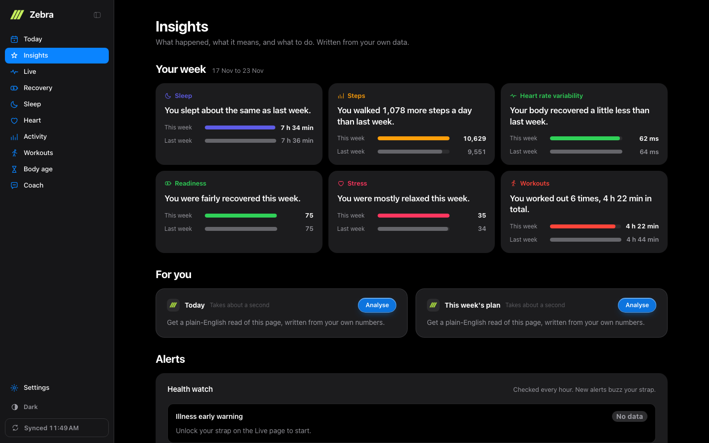 | 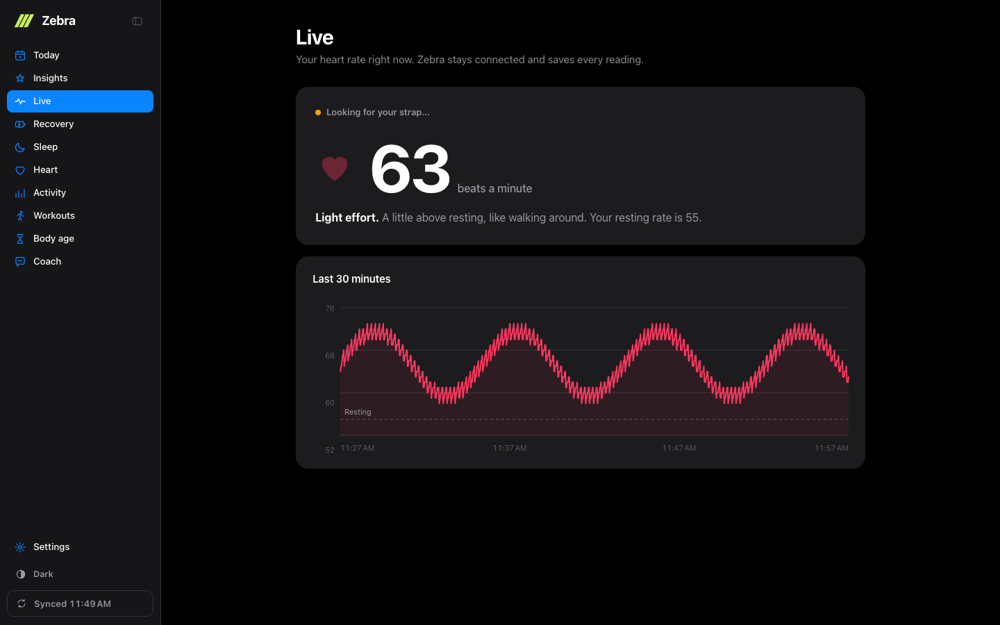 |
| 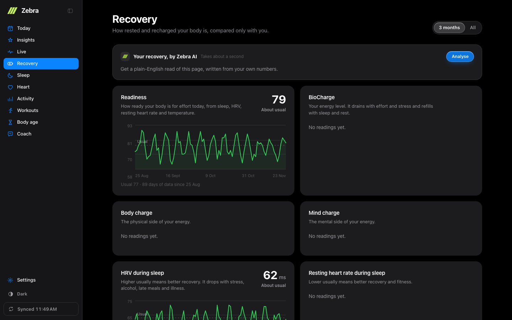 | 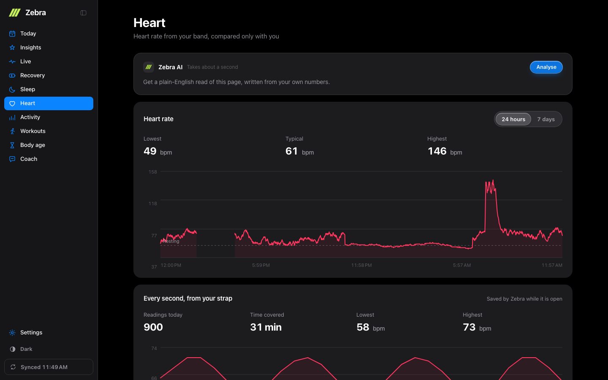 |
| 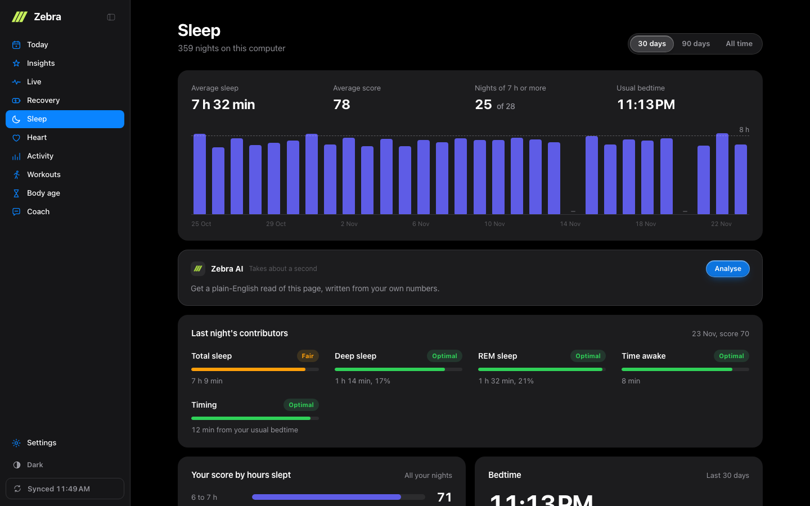 | 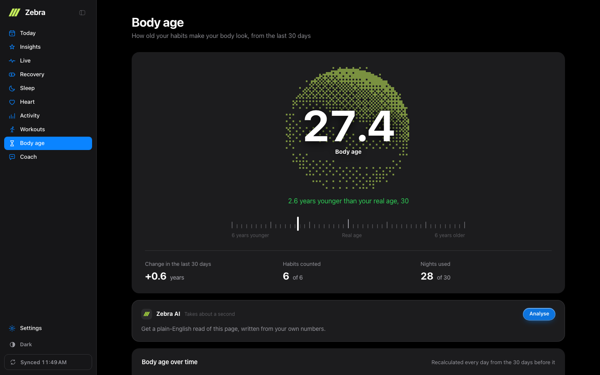 |
| 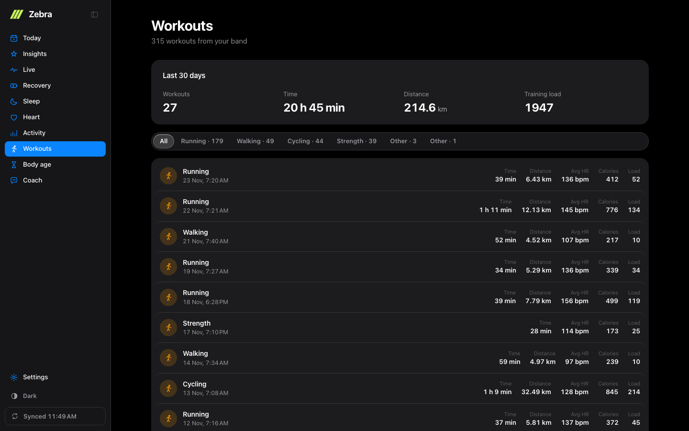 | 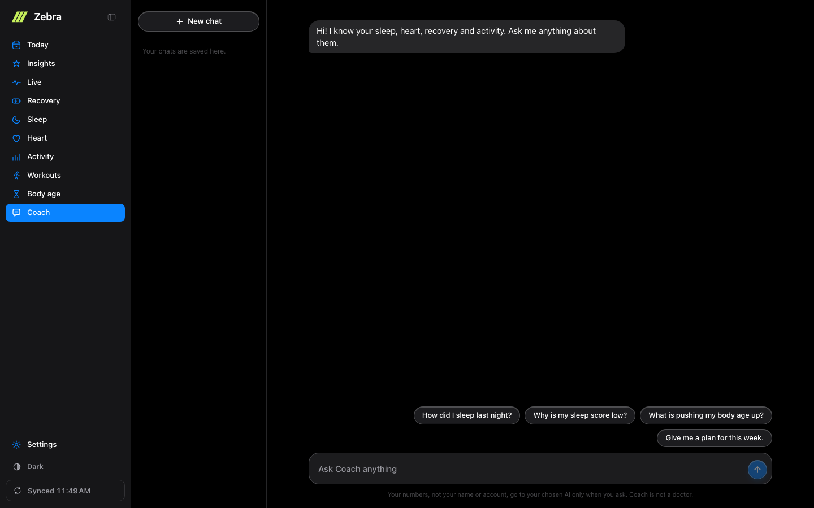 |
| 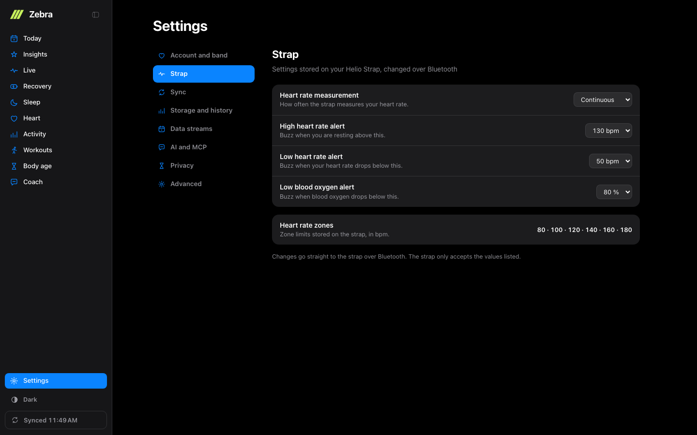 | 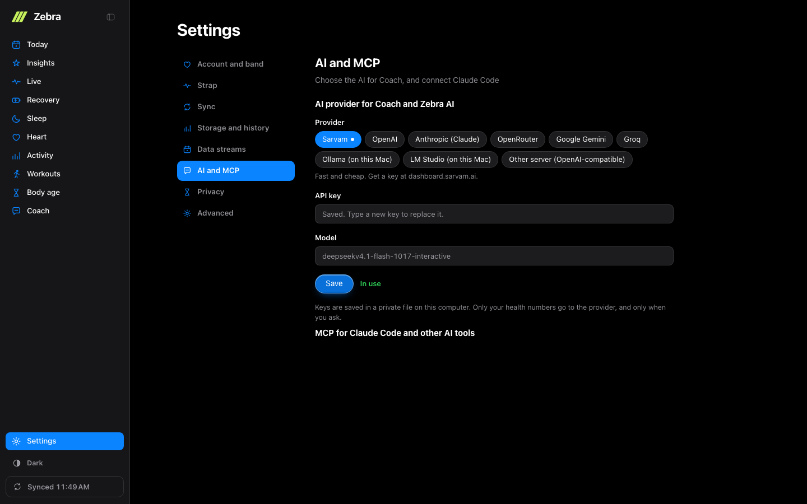 |

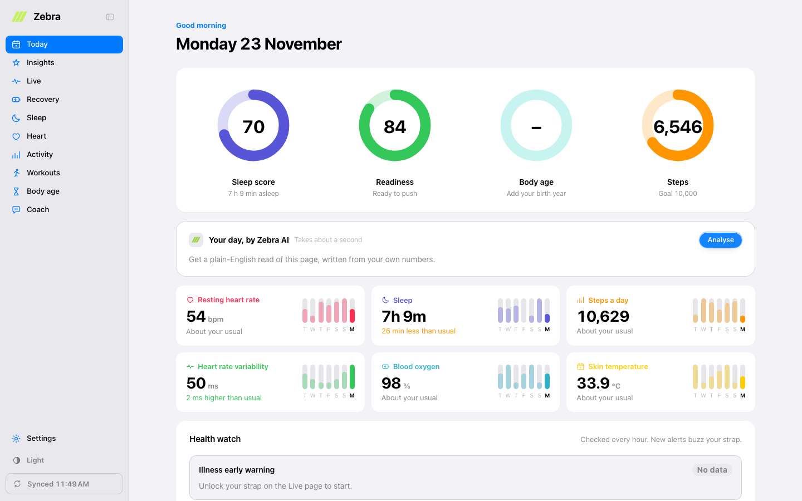

## Install

**Requirements:** a Mac (Apple Silicon), an Amazfit Helio Strap, and a Zepp account. Zebra signs in to your Zepp account to download your history.

1. Download **[Zebra.dmg](https://github.com/arjanchaudharyy/zebra-helio-strap/releases/download/zebra-v1.2.1/Zebra.dmg)**.
2. Open it and drag **Zebra** into **Applications**.
3. The app is not notarized by Apple yet, so macOS blocks the first launch. Run this once in Terminal:
   ```sh
   xattr -dr com.apple.quarantine /Applications/Zebra.app
   ```
   Or open it once, then go to **System Settings, Privacy & Security** and click **Open Anyway**.
4. Open Zebra, sign in with your Zepp account in **Settings, Account and band**, and let the first sync run.
5. Allow Bluetooth when macOS asks. The **Live** page then shows your heart rate.

**Windows and Linux:** not yet. Zebra is built with Tauri, so a Windows build is possible, but we have only built and tested it on macOS. Pull requests are welcome.

### Optional: strap features (history download, buzz, strap settings)

Live heart rate works out of the box. The deeper strap features (downloading history straight from the strap, health alerts on the wrist, changing strap settings) use a small Python client in [`strap/`](strap):

```sh
git clone https://github.com/arjanchaudharyy/zebra-helio-strap.git
cd zebra-helio-strap/strap
python3 -m venv .venv
.venv/bin/pip install -r requirements.txt
ln -s "$(pwd)" ~/zebra-ble        # or set ZEBRA_STRAP_DIR to this folder
```

Then open **Live** in Zebra once. Zebra gets your strap's key from your Zepp account and saves it in a private file on your Mac.

### AI

Open **Settings, AI and MCP** and pick a provider. Paste an API key, or choose Ollama or LM Studio to run a model on your Mac for free. Keys are saved in a private file on your Mac (mode 600). Only your health numbers go to the provider, never your name or account, and only when you ask.

A ChatGPT Plus or Claude Pro subscription does not include API access, so it cannot power Zebra. Use an API key, OpenRouter, or a local model.

### Use your data in any AI (MCP)

Install Zebra first. The server is inside the app at `/Applications/Zebra.app/Contents/MacOS/zeppbridge-mcp`. It reads your local database and needs no key. Then run one line for your tool:

```sh
# Claude Code
claude mcp add --scope user zebra -- /Applications/Zebra.app/Contents/MacOS/zeppbridge-mcp

# Codex (OpenAI)
codex mcp add zebra -- /Applications/Zebra.app/Contents/MacOS/zeppbridge-mcp

# Gemini CLI
gemini mcp add -s user zebra /Applications/Zebra.app/Contents/MacOS/zeppbridge-mcp
```

For Claude Desktop, Cursor, Windsurf, LM Studio and other apps, add this to their MCP config:

```json
{
  "mcpServers": {
    "zebra": { "command": "/Applications/Zebra.app/Contents/MacOS/zeppbridge-mcp" }
  }
}
```

Zebra's **Settings, AI and MCP** page shows the same commands with a copy button. Try asking:

- "How did I sleep this week compared with last week?"
- "What was my heart rate between 2 and 4 pm today?" (uses the strap's every-second data)
- "Is anything off with my recovery? Check my HRV and resting heart rate against my baseline."
- "Summarise my workouts this month."

The server is read-only for health data. It can write only a few things you can undo in the app (notes, workout labels, training plans).

### Wrist buzz for Claude Code

Add this to `~/.claude/settings.json`:

```json
{
  "hooks": {
    "Stop": [{ "hooks": [{ "type": "command", "command": "~/zebra-ble/buzz one", "async": true }] }],
    "Notification": [{ "hooks": [{ "type": "command", "command": "~/zebra-ble/buzz two", "async": true }] }]
  }
}
```

The strap has a vibration motor but no speaker or microphone.

## Build from source

```sh
npm install
npx tauri build --bundles app
```

You need Node 20+, Rust (see `rust-toolchain.toml`) and Xcode command line tools. `npm run dev` with `?demo=1` in the URL shows the app with demo data in a browser.

## What we learned about the strap

[`docs/zebra/helio-strap-hardware.md`](docs/zebra/helio-strap-hardware.md) maps everything we found: the data types the strap stores, how history is downloaded, the vibration motor, and a full dump of the strap's settings. Short version:

- The live heart rate signal carries bpm only. No beat-to-beat (RR) intervals, so live HRV is not possible.
- HRV (RMSSD and SDNN) comes from the strap's stored history, once a night.
- Heart rate is measured continuously. High and low heart rate and low oxygen alerts live on the strap.

## Credits

Zebra stands on the work of others. Thank you.

- **[ZeppBridge](https://github.com/lingcang728/ZeppBridge)** by LingCang Huang and contributors (MIT). Zebra is a fork of ZeppBridge v3.2.1: the Zepp cloud sync, the local database, the MCP server and the app foundation are theirs. We rebuilt the interface and added the strap, AI and insights features. Their original README is in [`docs/upstream/`](docs/upstream/README.zeppbridge.md).
- **[unstrap](https://github.com/sayed0am/unstrap)** (MIT or Apache-2.0). The Python strap client in `strap/` is a port of unstrap's Helio Strap protocol work: authentication, history download, vibration and settings.
- ZeppBridge also runs the relay at zeppbridge.com that Zepp's official sign-in uses. Zebra uses that relay for official sign-in only; nothing else is sent to it.
- **[zepp-fit-extractor](https://github.com/H3llK33p3r/zepp-fit-extractor)** (Apache-2.0), for workout-detail decoding, via ZeppBridge.
- Fonts and assets as listed in [NOTICE](NOTICE).

Zebra is not affiliated with Zepp Health, Amazfit or WHOOP. Zebra is not a medical device. Do not use it to diagnose or treat anything.

## License

MIT, see [LICENSE](LICENSE). Third-party notices are in [NOTICE](NOTICE).
